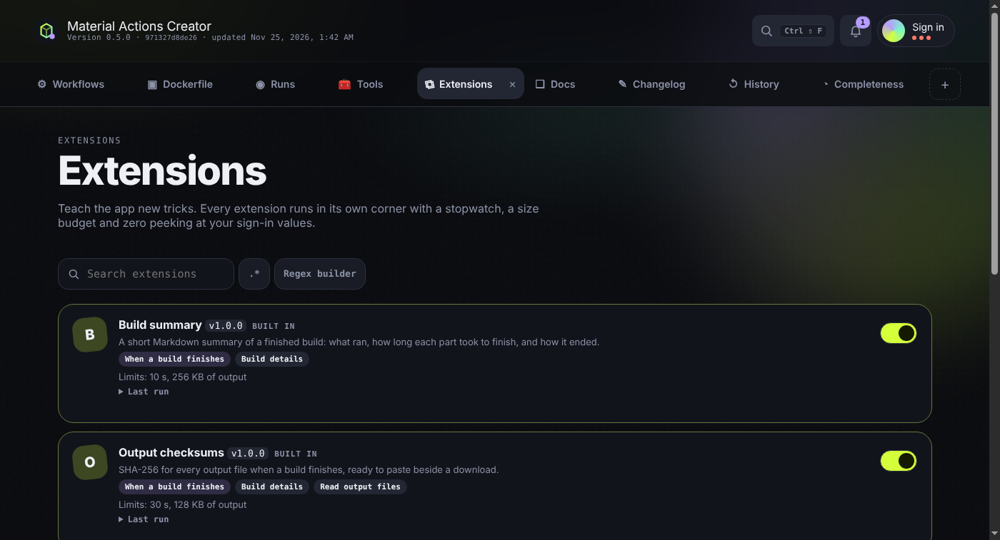

# Material Actions Creator

**Repo in. Installer out.** A self-hosted web app that turns a repository's build scripts (`.bat`, `.cmd`, `.ps1`, `.sh`) — or a Dockerfile — into a throwaway GitHub Actions run, hands the outputs back as downloads, and deletes the temporary repository it used.

- **Workflows tab** — pick a repository, scan for build scripts, tick and order them, choose a runner (Windows by default) and the output globs. A live preview shows the exact workflow; you can also download it.
- **Dockerfile tab** — Dockerfile instructions in, Docker image (`.tar.gz`) out.
- **Two run modes** — *Private temp repo*, or *Encrypted public builder*: a throwaway public repository that only ever holds ciphertext (see below).
- **The repository's own workflows** — scan lists `.github/workflows`; tick any (or **Run all workflows**) and they run inside the temporary repository, rewritten to a manual start with read-only permissions, publishing steps removed and, in encrypted mode, every artifact sealed before upload.
- **CLI** — `mac` does everything the web app does, including assisted GitHub CLI sign-in (see below).
- **Runs tab** — live stages, every output listed for download (auto-decrypted for encrypted runs), and builds that resume after a restart.

📖 Docs site: https://ding-ding-projects.github.io/material-actions-creator/

## How it works

1. Creates a private `mac-tmp-<id>` repository under `GITHUB_OWNER` (or the signed-in user).
2. Commits your Dockerfile and extra files into `context/`, plus a generated `build-image.yml` workflow.
3. Starts the workflow with `workflow_dispatch`.
4. Buildx (and QEMU for non-x86 platforms) builds the image, `docker save`s it, and uploads it as an artifact.
5. The server downloads the artifact and unpacks it into a plain `image.tar.gz`.
6. Deletes the repository — on success **and** on failure. A startup sweeper removes any `mac-tmp-*` repositories older than three hours.

Load the result with `docker load -i <file>.tar.gz`.

## CLI

```sh
npm install -g .            # or use `mac` inside the Docker image
mac login                   # assisted GitHub CLI device sign-in with repo, workflow, delete_repo
mac scan owner/repo         # build scripts + workflows, with what will change
mac build owner/repo --all-scripts --all-workflows --encrypted --out ./outputs
mac docker -f Dockerfile --file app.py --image my-app:1 --platform linux/arm64
mac runs | mac watch <id> | mac download <id> | mac rm <id> | mac sweep
mac preview owner/repo --script build/installer.bat --outputs "dist/*.exe"
mac serve --port 8080       # the web app
mac crypt seal|open|keygen  # the mac-crypt skill
```

By default the CLI runs a private engine in-process and keeps builds and the run journal in `~/.material-actions-creator` (override with `MAC_HOME`). Point it at a running server with `--server URL` (or `MAC_SERVER`) and `--key` (or `MAC_ACCESS_KEY`). Press Ctrl+C during a build and it keeps running on GitHub; `mac watch <id>` picks it up again. `--json` gives machine-readable output; `--detach` starts a build and returns its id.

## Running the repository's own workflows

Every workflow file goes into the temporary repository (so reusable workflows still resolve) and only the chosen ones start. Each is rewritten:

- triggers become `workflow_dispatch` (reusable workflows keep `workflow_call`), so committing never starts anything;
- workflow and job permissions become `contents: read, actions: read`; deployment environments are removed;
- after each checkout of the repository itself, the real sources are unpacked (decrypted first in encrypted mode);
- known publishing steps (GitHub releases, Pages, package publishing, auto-commits) are removed and `docker/build-push-action` stops pushing;
- encrypted mode seals every `upload-artifact` with mac-crypt and opens every `download-artifact`, so jobs still hand artifacts to each other but nothing readable is uploaded.

The scan shows every change per workflow (missing secrets, event checks, required inputs) before you start. The build is pinned to one commit, so pushes made while it runs don't mix in.

## Encrypted public builder

1. A fresh 32-byte key is made for the run (and, with a GitHub App configured, a 1-hour installation token).
2. Sources are sealed into `src.mac` with [mac-crypt](src/mac-crypt.mjs) (AES-256-GCM, chunked, position- and end-bound).
3. A public `mac-pub-*` repository gets `src.mac`, a copy of mac-crypt and the workflow; the key becomes the `MAC_KEY` Actions secret (sealed box).
4. The runner opens the sources, runs your scripts, seals the outputs into `out.mac` and uploads only that.
5. The app downloads and decrypts `out.mac`, lists every file, deletes the repository and revokes the token.

Still public: repository name, workflow, run logs, sizes and timing — scripts that print file contents print them publicly. **Read GitHub's Actions terms before relying on this mode**: throwaway public repositories holding only encrypted private code can look like avoiding Actions billing.

### Make any workflow encryption-ready

```yaml
- uses: Ding-Ding-Projects/material-actions-creator/.github/actions/mac-crypt@main
  with: { mode: open, key: "${{ secrets.MAC_KEY }}", input: src.mac, path: src }
# … build …
- uses: Ding-Ding-Projects/material-actions-creator/.github/actions/mac-crypt@main
  with: { mode: seal, key: "${{ secrets.MAC_KEY }}", path: src, globs: "dist/**/*.exe", output: out.mac }
```

CLI: `node src/mac-crypt.mjs keygen | seal <out> <base> <globs> | open <in> <dest>` (key in `MAC_KEY`).

## If the app closes mid-run

- **Browser tab closed:** nothing stops; reopen and it catches up.
- **Server stopped:** every stage is journaled to `/data/journal.json` (mode 0600; per-run keys are dropped as soon as a run finishes). On start, unfinished builds are reattached, their outputs downloaded and decrypted, and their repositories deleted. GitHub keeps artifacts for a day.
- **Never restarted:** the startup sweeper (or **Sweep leftovers**) deletes `mac-tmp-*` / `mac-pub-*` repositories older than three hours.

## Run

```sh
docker build -t material-actions-creator .
docker run -d --name mac -p 8080:8080 -v mac-data:/data \
  -e GITHUB_OWNER=Ding-Ding-Projects material-actions-creator
```

Open http://localhost:8080 and click **Sign in with GitHub CLI**. The server runs `gh auth login --web` with the scopes it needs (`repo`, `workflow`, `delete_repo`, `read:org`) and shows the one-time device code in the app. If an existing sign-in is missing scopes, **Add missing scopes** runs `gh auth refresh`.

Without Docker: `npm start` (Node 22+, and `gh` on the `PATH` for the assisted sign-in).

### Linux, without Docker

```sh
scripts/run-linux.sh                    # checks the machine, installs dependencies, starts on 127.0.0.1:8080
scripts/run-linux.sh --self-test        # spare port, throwaway data: server, API, extensions, clean stop
scripts/run-linux.sh --install-service  # systemd user service
```

Data goes to `~/.local/share/material-actions-creator`, settings to `~/.config/material-actions-creator/env`. See **Docs → Running on Linux** in the app.



## Extensions

An extension is a folder with a `manifest.json` and a program in any language. The app runs it as a separate process, sends one line of JSON and reads one line back, with a time limit, an output limit and none of your sign-in values. It asks before an extension first runs and whenever a new version wants a permission you have not allowed.

- Built in (`extensions/`): **Output checksums**, **Workflow lint**, **Build summary**.
- Samples for authors (`extension-samples/`): `hello-shell` (POSIX sh) and `word-count-python`.
- Guide: **Docs → Writing an extension** in the app, or [`public/docs/extensions.md`](public/docs/extensions.md).

Permissions decide what the app hands over; they are not an operating-system sandbox, so only add extensions you trust.

### Configuration

| Variable | Default | Purpose |
| --- | --- | --- |
| `GITHUB_OWNER` | signed-in user | Owner of the temporary repositories |
| `GITHUB_TOKEN` | — | Use this token instead of the GitHub CLI sign-in |
| `APP_ACCESS_KEY` | — | Require a key for the API and downloads |
| `PORT` | `8080` | HTTP port |
| `HOST` | `0.0.0.0` | Address to listen on (`127.0.0.1` from the Linux launcher) |
| `DATA_DIR` | `/data/builds` | Where finished images are kept |
| `GH_CONFIG_DIR` | `/data/gh` | GitHub CLI sign-in storage |
| `DOWNLOAD_TTL_MINUTES` | `60` | How long downloads stay available |
| `POLL_INTERVAL_MS` | `5000` | Workflow polling interval |
| `KEEP_REPO_ON_FAILURE` | `false` | Keep failed build repositories for debugging |
| `SWEEP_ON_START` | `true` | Delete stale `mac-tmp-*` / `mac-pub-*` repositories at startup |
| `GITHUB_APP_ID` / `GITHUB_APP_PRIVATE_KEY` / `GITHUB_APP_INSTALLATION_ID` | — | Mint 1-hour keys for encrypted runs (org installation with Administration, Contents, Actions and Secrets write) |
| `JOURNAL` | `true` | Crash-recovery journal |

## Tests

```sh
npm test
```

GitHub Actions in this repository:

- **`ci.yml`** — mac-crypt compatibility on Ubuntu, Windows and macOS (seal → unpack → run a real `.bat`/`.sh` → seal → open), unit + integration tests on Node 22 and 24 (fake GitHub API, fake `gh` binary), actionlint on this repo's workflows and on generated build workflows, Docker image build and container smoke test, and a Linux job that lints and runs the launcher's self-test and drives the real page in headless Chrome (`scripts/browser-check.mjs`).
- **`e2e.yml`** — live end-to-end: builds a real image through a throwaway repository, loads and runs it, and checks the repository is gone. Needs the `E2E_GITHUB_TOKEN` secret (classic token with `repo`, `workflow`, `delete_repo`); skipped without it.
- **`pages.yml`** — deploys the docs site in `docs/` to GitHub Pages.

## Security notes

- User files are written under `context/`, so they can't replace the workflow. Paths with `..`, absolute paths and duplicates are rejected.
- Image names, platforms and build args reach the workflow only through quoted `env:` values; `${{` is rejected so nothing is evaluated by Actions.
- The temporary workflow runs with `contents: read` and the artifact is kept for one day at most (the repository is deleted right after download anyway).
- The token is powerful (it can delete repositories). Put the app behind `APP_ACCESS_KEY` or a private network.
